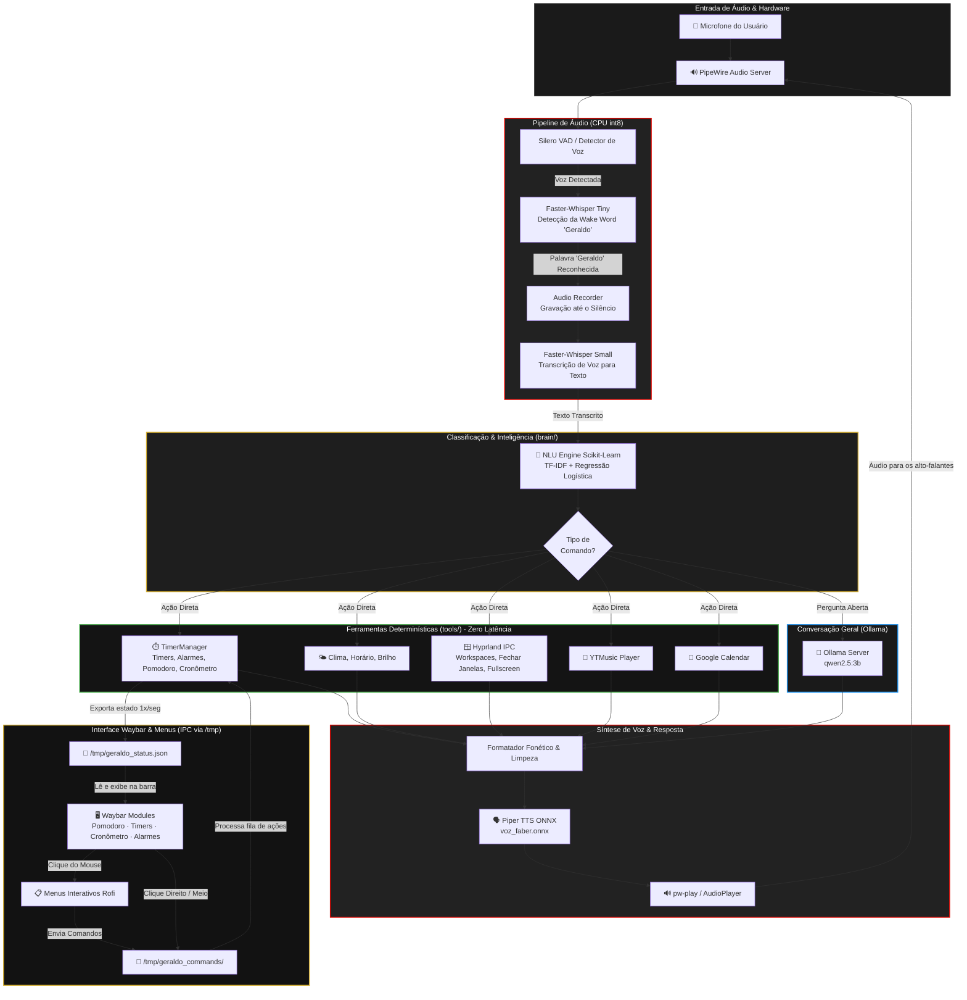

# Geraldo - Assistente de Voz Local Desktop

Documentação técnica da arquitetura, funcionamento interno, requisitos de hardware e integração de sistema do **Geraldo**.

---

## 1. Visão Geral e Funcionamento

O **Geraldo** é um assistente de voz local, nativo para Linux (otimizado para ambientes Wayland / Hyprland e PipeWire). Sua arquitetura foi projetada para ter **latência ultra-baixa**, **privacidade total** e **integração direta com o sistema operacional**.

O ciclo de funcionamento é dividido em 5 etapas principais:

### 1. Detecção de Ativação (*Wake Word*)
- O microfone captura áudio continuamente via PipeWire/ALSA em blocos pequenos com detecção de atividade de voz (VAD - *Voice Activity Detection*).
- Ao detectar voz, um modelo Whisper ultraleve (`whisper-tiny` em modo int8) avalia rapidamente se você pronunciou *"Geraldo"*.
- Ao acordar, o assistente emite um bipe de confirmação e aguarda sua instrução.

### 2. Transcrição de Comandos (*STT - Speech to Text*)
- O áudio do seu comando é gravado até você parar de falar.
- Um modelo mais preciso (`whisper-small` int8 multithreaded) transcreve sua voz para texto em português brasileiro com alta fidelidade sem depender de conexão externa.

### 3. Compreensão de Linguagem (*NLU - Natural Language Understanding*)
- O texto transcrito passa por um classificador local desenvolvido em Scikit-Learn (`TF-IDF + Regressão Logística`) que leva **menos de 1 milissegundo** para identificar a intenção e os parâmetros (*slots*).
- **Bifurcação de Inteligência:**
  - **Comandos Determinísticos (Zero LLM):** Se você pediu timers, alarmes, pomodoro, cronômetro, previsão do tempo, agenda, controle de janelas do Hyprland ou música, o Geraldo executa a ação **diretamente no Python**, sem chamar inteligência artificial generativa. A resposta é instantânea.
  - **Perguntas Abertas / Conversação:** Se você fez uma pergunta aberta (ex: *"por que o céu é azul?"*), a requisição é enviada ao Ollama local rodando o modelo `qwen2.5:3b`.

### 4. Síntese de Voz (*TTS - Text to Speech*)
- A resposta de texto é fonetizada e limpa (remoção de markdown, asteriscos e formatações).
- Enviada para o **Piper TTS**, que utiliza uma rede neural ONNX (`voz_faber.onnx`) para gerar a fala em português e tocá-la no PipeWire (`pw-play`).

### 5. Integração Bidirecional com a Waybar (IPC em `/tmp`)
- Em segundo plano, a classe `TimerManager` monitora continuamente cronômetros, alarmes, timers e os ciclos do pomodoro.
- O estado é exportado em tempo real para `/tmp/geraldo_status.json`, lido a cada segundo pelos scripts da Waybar.
- Quando você clica nos módulos da Waybar (ou abre menus via Rofi), comandos são enfileirados em `/tmp/geraldo_commands/` e executados imediatamente pelo Geraldo.

---

## 2. Requisitos de Hardware: Ele precisa de GPU?

**Não. O projeto foi projetado para rodar 100% em CPU.**

| Componente | Ferramenta / Modelo | Uso de Hardware | Precisa de GPU? |
| :--- | :--- | :--- | :--- |
| **Wake Word & STT** | `faster-whisper` (`tiny` + `small`) | Roda com quantização `int8` distribuído nas threads da CPU | **Não** (CPU puro) |
| **NLU / Roteamento** | Scikit-Learn (TF-IDF + Logistic Regression) | Cálculo matricial leve em CPU (< 1ms) | **Não** (CPU puro) |
| **Síntese de Voz (TTS)** | Piper TTS (`voz_faber.onnx`) | ONNX Runtime otimizado para CPU | **Não** (CPU puro) |
| **Ferramentas e IPC** | Python (`TimerManager`, Waybar, Hyprland) | Lógica e threads nativas | **Não** (CPU puro) |
| **LLM (Conversação)** | Ollama (`qwen2.5:3b`) | Modelo quantizado de 3 bilhões de parâmetros | **Opcional:** Se houver GPU (Nvidia CUDA / AMD ROCm), o Ollama a usará automaticamente; se não houver, o modelo roda tranquilamente na CPU. |

---

## 3. Ambiente de Execução: Ele precisa de Docker?

**Não, e não é recomendado colocá-lo em Docker.**

O Geraldo é um **serviço nativo do sistema operacional** gerenciado pelo Systemd do usuário (`systemctl --user start geraldo.service`) dentro de um ambiente virtual Python (`venv`).

Razões técnicas para execução direta no host:
1. **Acesso Direto ao Áudio (PipeWire/WirePlumber):** Captura do microfone e reprodução de áudio sem camadas extras de virtualização ou latência de sockets.
2. **Integração Desktop (Wayland / Hyprland / Rofi):** Controle de workspaces, janelas e diálogos interativos do Rofi na sessão gráfica do usuário.
3. **Barra de Tarefas (Waybar):** Leitura de arquivos em `/tmp/geraldo_status.json` e envio de comandos de cliques em tempo real via `/tmp/geraldo_commands/`.
4. **Desempenho e Latência:** A execução no host garante tempo de resposta imediato para comandos de voz.

---

## 4. Diagrama Visual de Arquitetura

---

## 5. Estrutura do Repositório

- `main.py`: Ponto de entrada do loop principal de voz e estados do assistente.
- `config.py`: Definições globais de áudio, VAD, nome do assistente e host do Ollama.
- `run.sh`: Script de inicialização usado pelo serviço systemd.
- `brain/`:
  - `stt.py`: Transcrição de voz (faster-whisper dual-engine tiny/small).
  - `nlu.py`: Classificador de intenções e extrator de entidades (Scikit-Learn).
  - `llm.py`: Roteamento de comandos determinísticos e integração com Ollama.
  - `tts.py`: Síntese de voz neural via Piper TTS (ONNX Runtime).
- `audio/`:
  - `recorder.py`: Gravação de áudio com VAD.
  - `wakeword.py`: Detecção da palavra-chave "Geraldo".
  - `player.py`: Reprodução de bipes e áudio no PipeWire.
- `tools/`:
  - `timer.py`: Gerenciamento de Timers, Alarmes, Cronômetro, Pomodoro e IPC da Waybar.
  - `system.py`: Horário, clima e ferramentas de sistema.
  - `hyprland.py`: Automação do gerenciador de janelas Hyprland.
  - `calendar.py`: Integração com o Google Calendar.
  - `ytmusic.py`: Controle de reprodução no YouTube Music.
  - `news.py` / `search.py`: Notícias e buscas na web.
